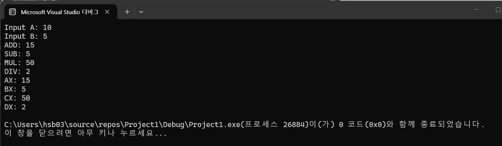

# 어셈블리어 사칙연산 및 레지스터 출력 프로그램

## 1. 프로그램 개요

두 개의 정수를 입력받아 덧셈, 뺄셈, 곱셈, 나눗셈을 수행하고, 각 연산 결과와 AX, BX, CX, DX 레지스터에 저장한 값을 화면에 출력하는 프로그램이다.

## 2. 개발 환경

- IDE: Microsoft Visual Studio 2022
- 언어: x86 Assembly (MASM)
- 플랫폼: x86 (32비트)
- 소스 파일: `hw2.asm`
- 사용 라이브러리: `msvcrt.lib`, `kernel32.lib`, `legacy_stdio_definitions.lib`, `ucrt.lib`

## 3. 프로그램 동작 과정

1. `printf`와 `scanf`를 이용하여 두 개의 16비트 정수를 입력받는다.
2. 나눗셈이 불가능한 경우(0으로 나누기 또는 -32768을 -1로 나누기)를 검사한다.
3. 어셈블리어 명령어를 이용하여 사칙연산을 수행한다.
4. 연산 결과를 메모리에 저장한 뒤 AX, BX, CX, DX 레지스터에 각각 불러온다.
5. 보관한 연산 결과와 레지스터 값을 `printf`로 출력한다.
6. `ExitProcess`를 호출하여 프로그램을 종료한다.

## 4. 주요 명령어 및 레지스터

| 연산 | 명령어 | 최종 저장 레지스터 |
| --- | --- | --- |
| 덧셈 | `ADD` | AX |
| 뺄셈 | `SUB` | BX |
| 곱셈 | `IMUL` | CX |
| 나눗셈 | `IDIV` | DX |

- `MOV`: 데이터를 이동한다.
- `CWD`: AX의 부호를 DX:AX로 확장하여 부호 있는 나눗셈을 준비한다.
- `MOVSX`: 16비트 부호 있는 값을 32비트로 확장하여 출력에 사용한다.
- `CMP`, `JE`, `JNE`: 비교 및 조건 분기를 수행한다.
- `IDIV` 실행 직후에는 AX에 몫, DX에 나머지가 저장되며, 이후 프로그램에서 몫을 DX에 다시 배치한다.

## 5. 실행 방법

1. Visual Studio에서 MASM이 설정된 프로젝트를 연다.
2. `hw2.asm` 파일에 소스 코드를 작성한다.
3. 솔루션 플랫폼을 `x86`으로 설정한다.
4. `Ctrl + F5`를 눌러 실행하고 두 정수를 입력한다.

## 6. 실행 결과

입력값 A = 10, B = 5로 실행한 실제 결과이다.

| 연산 | 계산식 | 결과 | 레지스터 |
| --- | --- | ---: | --- |
| 덧셈 | 10 + 5 | 15 | AX |
| 뺄셈 | 10 - 5 | 5 | BX |
| 곱셈 | 10 × 5 | 50 | CX |
| 나눗셈 | 10 ÷ 5 | 2 | DX |

실행 결과 모든 연산값이 예상값과 일치하며, 종료 코드 `0 (0x0)`으로 정상 종료되었음을 확인하였다.

## 7. 참고 사항

- 나눗셈은 정수 몫만 출력하며 소수점 이하와 나머지는 출력하지 않는다.
- 0으로 나누거나 -32768을 -1로 나누면 `Division error`를 출력하고 종료한다.
- 16비트 부호 있는 정수의 범위는 -32768~32767이며, 덧셈·뺄셈·곱셈 결과가 범위를 벗어나면 하위 16비트만 저장된다. 별도의 오버플로 검사 및 잘못된 입력 검사는 구현하지 않았다.
- 출력되는 레지스터 값은 출력 함수 호출 이전에 메모리에 보관한 값이다.

## 8. 결론

MASM 어셈블리어의 사칙연산 명령어를 사용하여 두 정수의 연산 결과를 계산하고, AX, BX, CX, DX 레지스터에 결과를 배치하여 화면에 출력하였다. 이를 통해 레지스터의 데이터 저장 방식과 정수 연산 명령어의 동작을 확인할 수 있었다.
